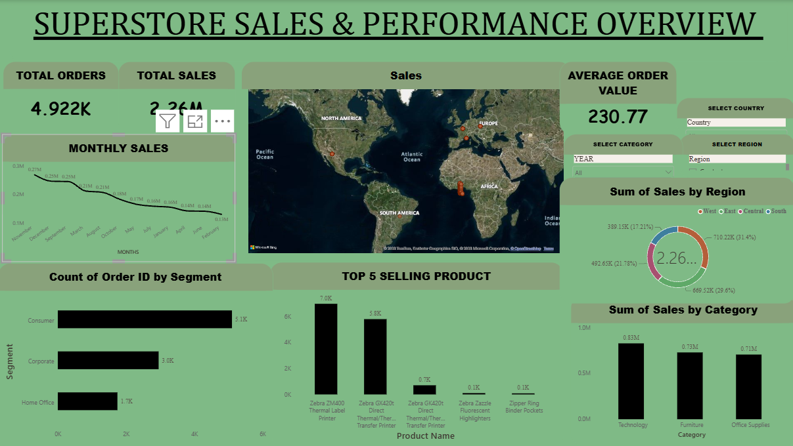

# 📊 Superstore Sales & Performance Overview (Power BI Dashboard)

## 📌 Project Overview
This interactive Power BI dashboard provides a comprehensive analysis of Superstore retail sales, order volume, regional distribution, and product performance. It is designed to help business stakeholders track key performance indicators (KPIs) and identify top-performing segments and categories.

## 🎯 Key KPIs & Insights
- **Total Orders:** 4.922K
- **Total Sales:** $2.26M
- **Average Order Value (AOV):** $230.77
- **Top Customer Segment:** Consumer segment leads with the highest order volume (5.1K), followed by Corporate (3.0K) and Home Office (1.7K).
- **Regional Performance:** Central (31.4%) and South (29.8%) regions generate over 60% of total sales.
- **Category Breakdown:** Technology ($0.83M) is the highest revenue-generating category, followed closely by Furniture ($0.73M) and Office Supplies ($0.71M).
- **Top-Selling Products:** Zebra ZM400 Thermal Label Printer leads product sales at 7.0K, followed by Zebra GX420t at 5.8K.

## 🛠️ Tools & Features Used
- **Power BI Desktop:** Data modeling, DAX calculations, and interactive report design.
- **Visualizations:** KPI Cards, Line Chart (Monthly Sales Trend), Filled/Bubble Map, Donut Chart, and Bar/Column Charts.
- **Interactive Slicers:** Dynamic filtering by **Year**, **Country**, and **Region**.

## 📸 Dashboard Preview

## 📂 Files in this Repository
- `Superstore_Sales_Dashboard.pbix` – Complete Power BI source file.
- `dashboard.png` – High-resolution screenshot of the dashboard.
- `README.md` – Project documentation and key business insights.
